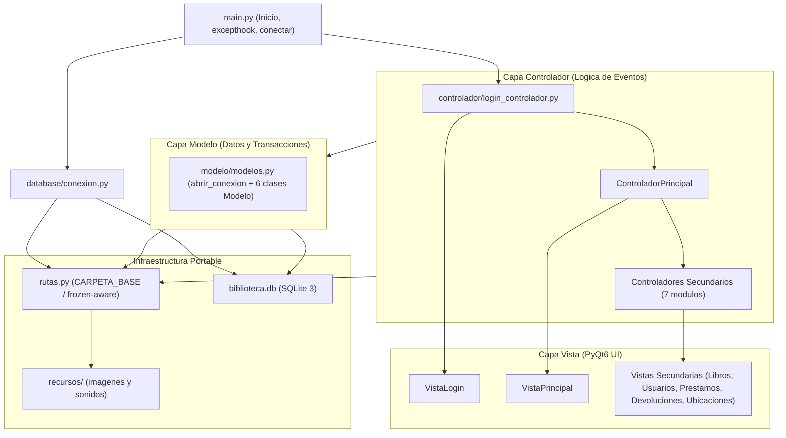
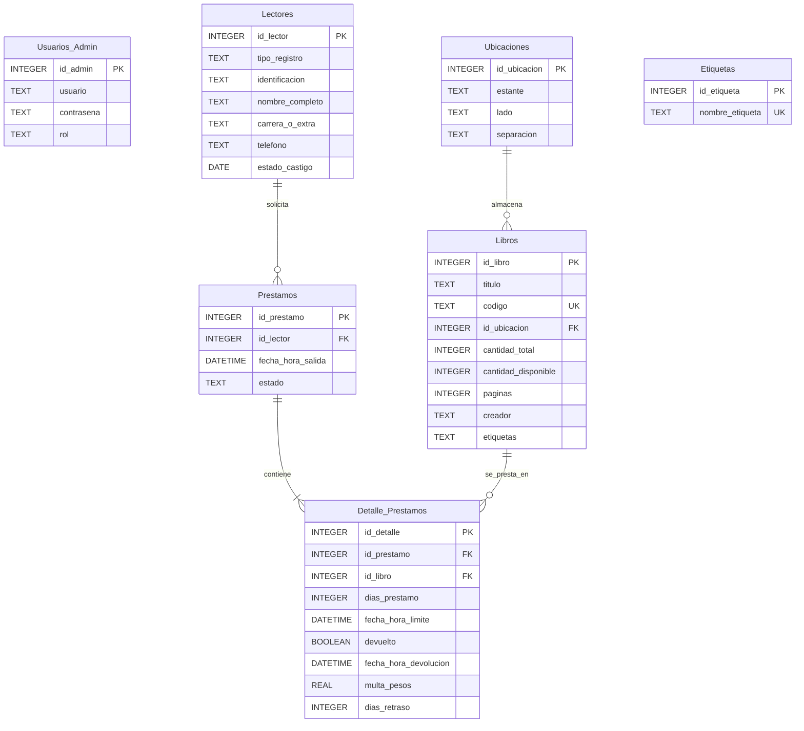
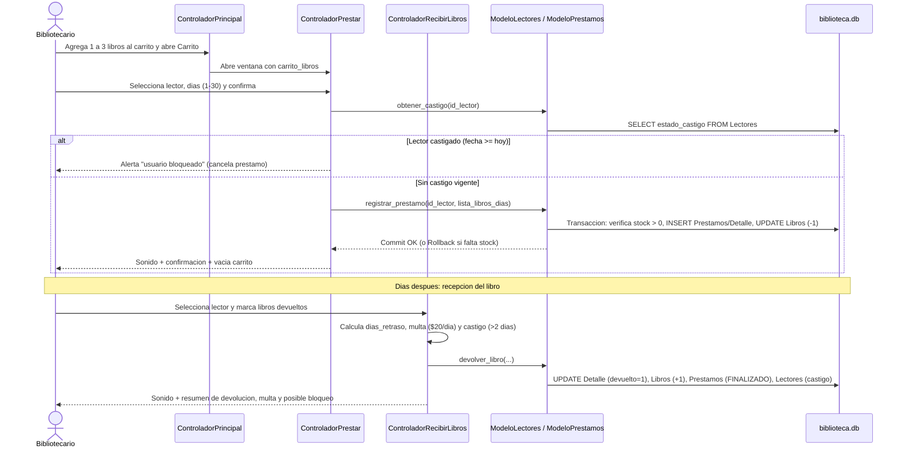

# Documentación Técnica y Manual de Usuario
## Sistema de Gestión de Biblioteca Universitaria

---

| Campo | Detalle |
| :--- | :--- |
| **Nombre del Proyecto** | Sistema de Gestión de Biblioteca Universitaria (Equipo 3) |
| **Tipo de Aplicación** | Aplicación de escritorio multiplataforma (Windows / Linux / macOS) |
| **Lenguaje y Framework** | Python 3 / PyQt6 |
| **Motor de Base de Datos** | SQLite 3 (embebido, sin servidor) |
| **Patrón de Arquitectura** | Modelo–Vista–Controlador (MVC) |
| **Versión del Documento** | 1.0 — Revisión Integral y Portabilidad |
| **Ámbito de Aplicación** | Administración bibliotecaria en instituciones universitarias |

---

## Tabla de Contenido

1. [Introducción](#1-introducción)
   - 1.1 [Antecedentes y Planteamiento del Problema](#11-antecedentes-y-planteamiento-del-problema)
   - 1.2 [Justificación](#12-justificación)
   - 1.3 [Objetivos](#13-objetivos)
   - 1.4 [Alcance del Sistema](#14-alcance-del-sistema)
2. [Especificación de Requisitos y Reglas de Negocio](#2-especificación-de-requisitos-y-reglas-de-negocio)
   - 2.1 [Requisitos Funcionales](#21-requisitos-funcionales)
   - 2.2 [Requisitos No Funcionales](#22-requisitos-no-funcionales)
   - 2.3 [Reglas de Negocio](#23-reglas-de-negocio)
3. [Arquitectura del Sistema](#3-arquitectura-del-sistema)
   - 3.1 [Patrón Modelo–Vista–Controlador (MVC)](#31-patrón-modelovistacontrolador-mvc)
   - 3.2 [Estructura de Directorios y Módulos](#32-estructura-de-directorios-y-módulos)
   - 3.3 [Diseño de Portabilidad (`rutas.py`)](#33-diseño-de-portabilidad-rutaspy)
4. [Diseño de la Base de Datos](#4-diseño-de-la-base-de-datos)
   - 4.1 [Esquema Entidad–Relación](#41-esquema-entidadrelación)
   - 4.2 [Diccionario de Datos](#42-diccionario-de-datos)
   - 4.3 [Inicialización Automática y Datos Semilla](#43-inicialización-automática-y-datos-semilla)
5. [Descripción Técnica de Módulos](#5-descripción-técnica-de-módulos)
   - 5.1 [Capa de Modelo (`modelo/modelos.py`)](#51-capa-de-modelo-modelomodelospy)
   - 5.2 [Capa de Controlador (`controlador/`)](#52-capa-de-controlador-controlador)
   - 5.3 [Capa de Vista (`vista/`)](#53-capa-de-vista-vista)
   - 5.4 [Flujo de Préstamo y Devolución](#54-flujo-de-préstamo-y-devolución)
6. [Manual de Usuario (Operación del Sistema)](#6-manual-de-usuario-operación-del-sistema)
   - 6.1 [Inicio de Sesión](#61-inicio-de-sesión)
   - 6.2 [Pantalla Principal y Búsqueda Inteligente](#62-pantalla-principal-y-búsqueda-inteligente)
   - 6.3 [Gestión de Libros y Portadas](#63-gestión-de-libros-y-portadas)
   - 6.4 [Registro y Edición de Lectores](#64-registro-y-edición-de-lectores)
   - 6.5 [Registro de Préstamos (Carrito)](#65-registro-de-préstamos-carrito)
   - 6.6 [Recepción de Devoluciones, Multas y Sanciones](#66-recepción-de-devoluciones-multas-y-sanciones)
   - 6.7 [Administración del Mapa de Ubicaciones](#67-administración-del-mapa-de-ubicaciones)
7. [Guía de Instalación, Portabilidad y Despliegue](#7-guía-de-instalación-portabilidad-y-despliegue)
   - 7.1 [Requisitos del Sistema](#71-requisitos-del-sistema)
   - 7.2 [Portabilidad Copiando la Carpeta (Con Python)](#72-portabilidad-copiando-la-carpeta-con-python)
   - 7.3 [Generación de Ejecutable Independiente (Sin Python)](#73-generación-de-ejecutable-independiente-sin-python)
   - 7.4 [Respaldo y Migración de Información](#74-respaldo-y-migración-de-información)
   - 7.5 [Solución de Problemas Frecuentes](#75-solución-de-problemas-frecuentes)
8. [Auditoría de Calidad, Corrección de Errores y Pruebas](#8-auditoría-de-calidad-corrección-de-errores-y-pruebas)
   - 8.1 [Errores Detectados y Resueltos](#81-errores-detectados-y-resueltos)
   - 8.2 [Verificación Automatizada Ejecutada](#82-verificación-automatizada-ejecutada)
9. [Conclusiones y Trabajo Futuro](#9-conclusiones-y-trabajo-futuro)

---

## 1. Introducción

### 1.1 Antecedentes y Planteamiento del Problema

Las bibliotecas universitarias constituyen un pilar fundamental para la formación académica y la investigación. En muchos planteles, departamentos o centros de documentación con recursos limitados, el control del acervo bibliográfico, el registro de usuarios y el seguimiento de préstamos aún se realizan mediante bitácoras en papel o hojas de cálculo aisladas. Esta práctica genera problemas recurrentes:

- **Descontrol de existencias reales:** dificultad para saber cuántos ejemplares están disponibles en estantería y cuántos se encuentran prestados.
- **Pérdida de localización física:** libros reubicados sin actualización de su estante, lado o separación, lo que retrasa la atención en mostrador.
- **Falta de control sobre vencimientos y sanciones:** cálculos manuales propensos a error al estimar días de atraso, multas económicas y suspensiones temporales de préstamo.
- **Dependencia de infraestructura compleja:** soluciones web o empresariales suelen exigir servidores dedicados, gestores de bases de datos externos y personal técnico para su instalación y migración entre equipos.

### 1.2 Justificación

El desarrollo de un sistema de escritorio autónomo, ligero y portable resuelve directamente la operación cotidiana del mostrador bibliotecario universitario sin requerir servidores ni licencias comerciales. Al emplear **Python**, **PyQt6** y **SQLite**, el sistema ofrece una interfaz gráfica moderna (tema oscuro de alto contraste pensado para jornadas prolongadas de mostrador), persistencia local confiable en un único archivo de base de datos (`biblioteca.db`) y la capacidad de trasladar toda la aplicación con sus datos de una computadora a otra simplemente copiando su carpeta.

### 1.3 Objetivos

#### Objetivo General
Proporcionar una aplicación de escritorio confiable, intuitiva y completamente portable que automatice el control del inventario bibliográfico, la ubicación física en estanterías, el padrón de lectores y el ciclo completo de préstamos y devoluciones de una biblioteca universitaria.

#### Objetivos Específicos
1. Centralizar el catálogo de libros con metadatos completos (título, código único, autor/creador, número de páginas, ejemplares totales/disponibles, ubicación física, etiquetas temáticas y portada).
2. Implementar un motor de búsqueda en tiempo real por título, código o etiqueta que sugiera adicionalmente obras relacionadas por afinidad temática.
3. Administrar el padrón de lectores diferenciando a la comunidad estudiantil (código de estudiante y carrera) del público general (CURP), evitando duplicidades.
4. Controlar el flujo de préstamos mediante un carrito de hasta 3 libros con plazos individuales, validación atómica de disponibilidad y verificación de sanciones vigentes.
5. Automatizar la recepción de devoluciones, el cálculo de días de retraso, la cuantificación de multas y la aplicación de bloqueos temporales por morosidad.
6. Ofrecer un mapa visual configurable de estantes, lados y separaciones que facilite la reubicación ordenada de ejemplares.
7. Garantizar la portabilidad total del sistema mediante rutas relativas, inicialización automática de la base de datos y scripts de ejecución/empaquetado.

### 1.4 Alcance del Sistema

**Incluye:**
- Autenticación del administrador/bibliotecario.
- CRUD completo de libros, gestión de etiquetas y manejo local de imágenes de portada.
- Alta, consulta y modificación de lectores (estudiantes y público externo).
- Mapa dinámico de estantes (`A`–`Z`), lados (`1`–`2`) y separaciones numéricas.
- Préstamos con carrito (hasta 3 títulos por transacción, 1–30 días por libro).
- Devoluciones selectivas con cálculo automático de multas y aplicación de castigos.
- Retroalimentación sonora en operaciones exitosas y capturador global de excepciones críticas.
- Portabilidad directa en Windows, Linux y macOS, más generación opcional de ejecutable `.exe`.

**Fuera de alcance en esta versión (véase la Sección 9 para evolución futura):**
- Operación multiusuario simultánea en red cliente-servidor.
- Emisión de recibos impresos o exportación de reportes a PDF/Excel.
- Portal público de consulta para estudiantes vía web.

---

## 2. Especificación de Requisitos y Reglas de Negocio

### 2.1 Requisitos Funcionales

| ID | Módulo | Descripción | Prioridad |
| :--- | :--- | :--- | :---: |
| **RF-01** | Autenticación | El sistema debe validar usuario y contraseña contra la tabla `Usuarios_Admin` antes de permitir el acceso al panel principal. | Alta |
| **RF-02** | Catálogo | El sistema debe mostrar todos los libros registrados en una cuadrícula visual (4 columnas) con portada, título, etiquetas y acceso a detalles. | Alta |
| **RF-03** | Búsqueda | El sistema debe filtrar libros en tiempo real por título, código o `#etiqueta`, mostrando primero las coincidencias directas y después libros similares con etiquetas en común. | Alta |
| **RF-04** | Libros | El sistema debe permitir registrar nuevos libros con código único, asignar etiquetas existentes o nuevas, y adjuntar una imagen de portada (`.png`, `.jpg`, `.jpeg`). | Alta |
| **RF-05** | Libros | El sistema debe permitir editar los datos de un libro (excepto su código identificador), cambiar o borrar su portada y eliminarlo únicamente si no tiene copias prestadas. | Alta |
| **RF-06** | Lectores | El sistema debe registrar lectores de tipo `escuela` (código de estudiante + carrera) o `publico general` (CURP), validando nombre sin dígitos, teléfono de 10 dígitos y no duplicidad de identificación. | Alta |
| **RF-07** | Lectores | El sistema debe permitir buscar lectores por nombre, identificación o teléfono y actualizar sus datos de contacto y carrera. | Media |
| **RF-08** | Carrito / Préstamos | El sistema debe permitir acumular hasta 3 libros distintos en un carrito de préstamos, quitar libros individuales o vaciar el carrito completo. | Alta |
| **RF-09** | Préstamos | El sistema debe asignar entre 1 y 30 días por cada libro del carrito, impedir préstamos a lectores con castigo vigente y descontar atómicamente la disponibilidad. | Alta |
| **RF-10** | Devoluciones | El sistema debe listar únicamente los lectores con libros pendientes de entrega y permitir devolver ejemplares de forma total o parcial. | Alta |
| **RF-11** | Multas y Castigos | Al devolver un libro fuera de plazo, el sistema debe calcular los días de retraso, la multa económica y, si corresponde, registrar la fecha de bloqueo del lector. | Alta |
| **RF-12** | Ubicaciones | El sistema debe visualizar cada estante dividido en Lado 1 (Izquierdo) y Lado 2 (Derecho), permitiendo crear/eliminar estantes y separaciones con opción de reubicar masivamente libros afectados. | Media |

### 2.2 Requisitos No Funcionales

| ID | Categoría | Descripción |
| :--- | :--- | :--- |
| **RNF-01** | Portabilidad | El sistema no debe contener rutas absolutas fijas; copiar la carpeta completa a otro equipo debe preservar funcionamiento, base de datos, portadas y sonidos. |
| **RNF-02** | Auto-inicialización | Si `biblioteca.db` no existe al iniciar, el sistema debe crear automáticamente todas las tablas y cargar los datos semilla indispensables. |
| **RNF-03** | Integridad de Datos | Todas las operaciones de base de datos deben ejecutarse dentro de transacciones seguras con `commit`, `rollback` ante fallos y cierre garantizado de conexiones. |
| **RNF-04** | Usabilidad | Interfaz coherente en tema oscuro (`#141414` / `#2b2b2b` / acento `#E50914`), respuestas inmediatas en buscadores y alertas claras ante errores de validación. |
| **RNF-05** | Tolerancia a Fallos | Un manejador global (`sys.excepthook`) debe interceptar excepciones no previstas y mostrar la traza técnica para diagnóstico sin cerrar silenciosamente la app. |
| **RNF-06** | Compatibilidad | Compatible con Python 3.9+ y PyQt6 en Windows 10/11, Linux y macOS; compatible con empaquetado congelado vía PyInstaller. |
| **RNF-07** | Rendimiento | Operaciones de búsqueda y actualización sobre SQLite local con tiempos de respuesta inferiores a 100 ms para catálogos universitarios de miles de títulos. |

### 2.3 Reglas de Negocio

1. **Normalización de texto:** Los campos alfabéticos clave (títulos, códigos, autores, nombres de lectores, identificaciones, carreras y etiquetas) se almacenan en **MAYÚSCULAS** y sin espacios sobrantes al inicio o final.
2. **Unicidad de códigos:** Cada libro tiene un `codigo` único (`UNIQUE`) que además define el nombre de su archivo de portada (`recursos/imagenes/<CODIGO>.<ext>`). Por seguridad del sistema de archivos, el código no puede contener caracteres reservados (`/ \ : * ? " < > |`).
3. **Unicidad de lectores:** No se permite registrar dos lectores con la misma `identificacion` (código de estudiante o CURP).
4. **Límite del carrito:** Un préstamo puede agrupar como máximo **3 libros diferentes** simultáneamente.
5. **Plazo y tolerancia:** Cada libro se presta por un plazo configurable de **1 a 30 días**, al cual el sistema añade automáticamente **5 horas de tolerancia** al calcular `fecha_hora_limite`.
6. **Cálculo de retraso y multa:** Si la fecha/hora de devolución supera `fecha_hora_limite`, cualquier fracción adicional cuenta como día completo (`dias_retraso = diferencia.days + (1 si diferencia.seconds > 0)`). La tarifa de multa es de **\$20.00 MXN por día de retraso por libro**.
7. **Política de sanción (castigo):** Si un libro se devuelve con **más de 2 días de retraso** (`dias_retraso > 2`), el lector recibe automáticamente un bloqueo de **7 días naturales** (`estado_castigo = hoy + 7 días`). Mientras `estado_castigo >= fecha_actual`, el sistema bloquea cualquier nuevo préstamo a ese lector.
8. **Consistencia de inventario:**
   - Al editar un libro, `cantidad_disponible` se recalcula como `cantidad_total - copias_prestadas_activas` y se prohíbe establecer una `cantidad_total` menor a las copias actualmente prestadas.
   - Al devolver un libro, `cantidad_disponible` nunca puede exceder `cantidad_total`.
   - No se puede eliminar un libro mientras tenga ejemplares prestados sin devolver.
   - Cuando se devuelven todos los libros de un registro en `Prestamos`, su `estado` cambia automáticamente de `ACTIVO` a `FINALIZADO`.
9. **Integridad de ubicaciones:** Al eliminar un estante completo, el sistema solicita confirmación indicando cuántos libros se verán afectados y asigna `id_ubicacion = NULL` (sin ubicación asignada) a dichos ejemplares. Al eliminar la última separación de un estante que contiene libros, el sistema ofrece moverlos en bloque a otra ubicación disponible o dejarlos sin ubicación.

---

## 3. Arquitectura del Sistema

### 3.1 Patrón Modelo–Vista–Controlador (MVC)

El sistema implementa una separación estricta en tres capas principales apoyadas por un módulo transversal de rutas y un módulo de inicialización de base de datos:



- **Vista (`vista/`):** Define exclusivamente ventanas (`QWidget`), layouts, hojas de estilo (QSS) y cuadros de mensaje. No contiene consultas SQL ni lógica de negocio.
- **Controlador (`controlador/`):** Conecta las señales de PyQt6 (`clicked`, `textChanged`, `currentIndexChanged`, `returnPressed`), valida entradas del usuario, coordina el carrito y delega la persistencia a la capa Modelo.
- **Modelo (`modelo/modelos.py`):** Encapsula todas las consultas SQL parametrizadas (previniendo inyección SQL) y la lógica transaccional mediante el gestor de contexto `abrir_conexion()`.

### 3.2 Estructura de Directorios y Módulos

| Archivo / Carpeta | Responsabilidad Principal |
| :--- | :--- |
| `main.py` | Punto de entrada. Instala el manejador global de errores (`manejador_errores`), inicializa `QApplication`, invoca `conectar()` para asegurar la BD y muestra el Login. |
| `rutas.py` | Centraliza la resolución de rutas relativas (`CARPETA_BASE`, `RUTA_DB`, `RUTA_IMAGENES`, `RUTA_SONIDO_EXITO`) y provee funciones auxiliares para portadas (`buscar_portada`, `guardar_portada`, `borrar_portadas`). |
| `database/conexion.py` | Define el esquema SQL (`CREATE TABLE IF NOT EXISTS`) y siembra datos iniciales (admin por defecto, estantes A y B, etiquetas base). |
| `modelo/modelos.py` | Contiene `abrir_conexion()` y las 6 clases de acceso a datos: `ModeloLogin`, `ModeloEtiquetas`, `ModeloLibros`, `ModeloUbicaciones`, `ModeloLectores`, `ModeloPrestamos`. |
| `controlador/login_controlador.py` + `vista/login_vista.py` | Autenticación del bibliotecario y transición hacia la ventana principal. |
| `controlador/principal_controlador.py` + `vista/principal_vista.py` | Pantalla principal maximizada, barra de búsqueda en vivo, cuadrícula de libros, gestión en memoria del carrito y menú de módulos administrativos. |
| `controlador/anadir_libro_controlador.py` + `vista/anadir_libro_vista.py` | Formulario dual para alta y edición de libros, gestión de etiquetas y selección de portada. |
| `controlador/detalles_libro_controlador.py` + `vista/detalles_libro_vista.py` | Ficha detallada del libro, gestión rápida de portada, envío al carrito, préstamo directo y eliminación segura. |
| `controlador/anadir_usuario_controlador.py` + `vista/anadir_usuario_vista.py` | Registro de lectores (estudiantes y público general) con validaciones de formato y unicidad. |
| `controlador/editar_usuario_controlador.py` + `vista/editar_usuario_vista.py` | Buscador y actualización de datos de lectores registrados. |
| `controlador/prestar_controlador.py` + `vista/prestar_vista.py` | Selección de lector, configuración de días por ejemplar, gestión del carrito (quitar/vaciar), validación de castigo y confirmación del préstamo con sonido. |
| `controlador/recibir_libros_controlador.py` + `vista/recibir_libros_vista.py` | Búsqueda de lectores con adeudos vigentes, selección de ejemplares devueltos, cálculo de multas/castigos y actualización de inventario. |
| `controlador/ubicaciones_controlador.py` + `vista/ubicaciones_vista.py` | Mapa interactivo de estantes (Lado 1 y Lado 2), alta/baja de separaciones y estantes, y diálogo de reubicación masiva. |
| `recursos/imagenes/` | Repositorio local de portadas nombradas por `<CODIGO>.<ext>`. |
| `recursos/sonidos/exito.wav` | Efecto de audio reproducido al confirmar préstamos y devoluciones. |
| `iniciar.bat` / `iniciar.sh` | Lanzadores portables con detección de Python e instalación automática de `PyQt6` en el primer uso. |
| `construir_exe.bat` | Generador de paquete autónomo (`dist\Biblioteca\Biblioteca.exe`) con PyInstaller. |
| `requirements.txt` | Declaración de dependencias (`PyQt6>=6.5`). |

### 3.3 Diseño de Portabilidad (`rutas.py`)

Para asegurar que copiar la carpeta del proyecto a otra PC nunca rompa las referencias a archivos, `rutas.py` calcula `CARPETA_BASE` dinámicamente en tiempo de ejecución:

- **Modo código fuente (Python):** `CARPETA_BASE = os.path.dirname(os.path.abspath(__file__))`.
- **Modo ejecutable congelado (PyInstaller):** detecta `getattr(sys, "frozen", False)` y usa `os.path.dirname(os.path.abspath(sys.executable))`, manteniendo `biblioteca.db` y `recursos/` editables y respaldables junto al `.exe`.

Además, las funciones de portada normalizan las extensiones a minúsculas (`.png`, `.jpg`, `.jpeg`) y eliminan automáticamente versiones previas con otra extensión para evitar archivos duplicados al migrar entre sistemas operativos sensibles a mayúsculas/minúsculas (Linux) y no sensibles (Windows).

---

## 4. Diseño de la Base de Datos

### 4.1 Esquema Entidad–Relación



### 4.2 Diccionario de Datos

#### Tabla `Usuarios_Admin`
Almacena las credenciales del personal autorizado para operar el sistema.

| Columna | Tipo | Restricción | Descripción |
| :--- | :--- | :--- | :--- |
| `id_admin` | `INTEGER` | `PRIMARY KEY AUTOINCREMENT` | Identificador único del administrador. |
| `usuario` | `TEXT` | — | Nombre de usuario para inicio de sesión. |
| `contrasena` | `TEXT` | — | Contraseña de acceso. |
| `rol` | `TEXT` | — | Perfil del operador (ej. `bibliotecario`). |

#### Tabla `Lectores`
Padrón de usuarios habilitados para solicitar préstamos.

| Columna | Tipo | Restricción | Descripción |
| :--- | :--- | :--- | :--- |
| `id_lector` | `INTEGER` | `PRIMARY KEY AUTOINCREMENT` | Identificador interno del lector. |
| `tipo_registro` | `TEXT` | — | Clasificación: `escuela` o `publico general`. |
| `identificacion` | `TEXT` | — | Código de estudiante o CURP (validado sin duplicados en alta). |
| `nombre_completo` | `TEXT` | — | Nombre completo en mayúsculas, sin dígitos. |
| `carrera_o_extra` | `TEXT` | — | Carrera universitaria (en `escuela`) o vacío (en `publico general`). |
| `telefono` | `TEXT` | — | Teléfono de contacto a 10 dígitos numéricos. |
| `estado_castigo` | `DATE` | `NULL` permitido | Fecha (`YYYY-MM-DD`) hasta la cual el lector tiene bloqueados los préstamos. |

#### Tabla `Ubicaciones`
Catálogo de coordenadas físicas dentro de la biblioteca.

| Columna | Tipo | Restricción | Descripción |
| :--- | :--- | :--- | :--- |
| `id_ubicacion` | `INTEGER` | `PRIMARY KEY AUTOINCREMENT` | Identificador único del espacio físico. |
| `estante` | `TEXT` | — | Letra del estante (`A`–`Z`). |
| `lado` | `TEXT` | — | Cara del estante: `1` (Izquierdo) o `2` (Derecho). |
| `separacion` | `TEXT` | — | Número de nivel/separación dentro del estante (`1`, `2`, `3`, ...). |

#### Tabla `Libros`
Inventario principal del acervo bibliográfico.

| Columna | Tipo | Restricción | Descripción |
| :--- | :--- | :--- | :--- |
| `id_libro` | `INTEGER` | `PRIMARY KEY AUTOINCREMENT` | Identificador interno del título. |
| `titulo` | `TEXT` | — | Título del libro en mayúsculas. |
| `codigo` | `TEXT` | `UNIQUE` | Código único de inventario; vincula también la imagen de portada. |
| `id_ubicacion` | `INTEGER` | `FK -> Ubicaciones(id_ubicacion)` | Espacio físico asignado (`NULL` si está sin ubicación). |
| `cantidad_total` | `INTEGER` | — | Total de ejemplares propiedad de la biblioteca. |
| `cantidad_disponible` | `INTEGER` | — | Ejemplares disponibles actualmente en estantería. |
| `paginas` | `INTEGER` | — | Número de páginas (0 a 10,000). |
| `creador` | `TEXT` | — | Autor o creador de la obra. |
| `etiquetas` | `TEXT` | — | Lista de etiquetas temáticas separadas por espacio (ej. `#CIENCIA #FICCION`). |

#### Tabla `Prestamos`
Encabezado de cada operación de préstamo.

| Columna | Tipo | Restricción | Descripción |
| :--- | :--- | :--- | :--- |
| `id_prestamo` | `INTEGER` | `PRIMARY KEY AUTOINCREMENT` | Folio único de préstamo. |
| `id_lector` | `INTEGER` | `FK -> Lectores(id_lector)` | Lector responsable del préstamo. |
| `fecha_hora_salida` | `DATETIME` | — | Marca temporal de registro (`YYYY-MM-DD HH:MM:SS`). |
| `estado` | `TEXT` | — | `ACTIVO` mientras haya libros pendientes; cambia a `FINALIZADO` al devolver todos. |

#### Tabla `Detalle_Prestamos`
Desglose por ejemplar dentro de un préstamo y registro histórico de devoluciones/multas.

| Columna | Tipo | Restricción | Descripción |
| :--- | :--- | :--- | :--- |
| `id_detalle` | `INTEGER` | `PRIMARY KEY AUTOINCREMENT` | Identificador único del renglón de préstamo. |
| `id_prestamo` | `INTEGER` | `FK -> Prestamos(id_prestamo)` | Préstamo al que pertenece el ejemplar. |
| `id_libro` | `INTEGER` | `FK -> Libros(id_libro)` | Libro prestado. |
| `dias_prestamo` | `INTEGER` | — | Días autorizados (1–30). |
| `fecha_hora_limite` | `DATETIME` | — | Fecha/hora máxima de entrega (días + 5 h de tolerancia). |
| `devuelto` | `BOOLEAN` | — | `0` (pendiente) o `1` (devuelto). |
| `fecha_hora_devolucion` | `DATETIME` | `NULL` mientras activo | Marca temporal en que se recibió el ejemplar. |
| `multa_pesos` | `REAL` | — | Importe calculado en pesos mexicanos (`dias_retraso * 20.0`). |
| `dias_retraso` | `INTEGER` | — | Días completos (redondeo hacia arriba) de demora. |

#### Tabla `Etiquetas`
Catálogo maestro de etiquetas reutilizables para clasificación y recomendaciones.

| Columna | Tipo | Restricción | Descripción |
| :--- | :--- | :--- | :--- |
| `id_etiqueta` | `INTEGER` | `PRIMARY KEY AUTOINCREMENT` | Identificador único de la etiqueta. |
| `nombre_etiqueta` | `TEXT` | `UNIQUE` | Nombre en formato `#ETIQUETA` (sin espacios internos). |

### 4.3 Inicialización Automática y Datos Semilla

Al arrancar `main.py`, se invoca `database.conexion.conectar()`, que ejecuta `CREATE TABLE IF NOT EXISTS` para las 7 tablas y, si están vacías, inserta automáticamente:

1. **Administrador inicial:** usuario `admin`, contraseña `1234`, rol `bibliotecario`.
2. **Ubicaciones iniciales:** 20 espacios correspondientes a los estantes `A` y `B`, lados `1` y `2`, separaciones `1` a `5` (códigos `A1-1` a `B2-5`).
3. **Etiquetas base:** `#TERROR`, `#DIVERSION`, `#CIENCIA`, `#FICCION`, `#ROMANCE`.

---

## 5. Descripción Técnica de Módulos

### 5.1 Capa de Modelo (`modelo/modelos.py`)

Todas las consultas utilizan el gestor de contexto `abrir_conexion()`, que abre SQLite, ejecuta `commit()` al finalizar sin errores, aplica `rollback()` ante cualquier excepción y cierra siempre la conexión en `finally` para impedir bloqueos (`database is locked`).

| Clase | Métodos Principales | Descripción |
| :--- | :--- | :--- |
| `ModeloLogin` | `verificar_usuario(usuario, contrasena)` | Valida credenciales administrativas. |
| `ModeloEtiquetas` | `obtener_etiquetas()`, `anadir_etiqueta(nombre)` | Lista e inserta etiquetas (`INSERT OR IGNORE`). |
| `ModeloLibros` | `obtener_todos_los_libros()`, `buscar_libros(texto)`, `anadir_libro(...)`, `contar_prestados(id)`, `obtener_libro_por_id(id)`, `actualizar_libro(...)`, `eliminar_libro(id)`, `obtener_libros_por_ubicaciones(ids)`, `mover_libros_masivo(viejas, nueva)` | Gestión integral del catálogo, motor de búsqueda + sugerencias por etiquetas, control de disponibilidad y reubicación masiva. |
| `ModeloUbicaciones` | `obtener_ubicaciones()`, `obtener_ubicacion_por_id(id)`, `anadir_ubicacion(...)`, `contar_libros_estante(estante)`, `eliminar_estante(estante)`, `eliminar_ultima_separacion(estante)`, `obtener_ids_separacion(estante, sep)` | Administración de la estructura física de estantes y desasignación segura al borrar estantes. |
| `ModeloLectores` | `anadir_lector(...)`, `existe_identificacion(id, excluir)`, `obtener_castigo(id)`, `buscar_lectores(texto)`, `buscar_lectores_con_prestamos(texto)`, `actualizar_lector(...)` | Gestión de lectores, control de unicidad, consulta de vigencia de castigos y filtrado de deudores con libros vigentes. |
| `ModeloPrestamos` | `registrar_prestamo(id_lector, lista)`, `obtener_prestamos_activos(id_lector)`, `devolver_libro(...)` | Registro atómico de préstamos con verificación real de stock, consulta de adeudos y devolución con cierre automático del estado del préstamo. |

### 5.2 Capa de Controlador (`controlador/`)

- **`ControladorLogin`**: Escucha clic en *Ingresar* y tecla `Enter` en ambos campos; limpia espacios en el usuario y abre `ControladorPrincipal` al autenticar.
- **`ControladorPrincipal`**: Gestiona el catálogo en cuadrícula de 4 columnas, búsqueda dinámica, mantenimiento en memoria del `carrito_libros` (`anadir_al_carrito`, `quitar_del_carrito`, `vaciar_carrito`) y apertura de las 6 ventanas operativas.
- **`ControladorAnadirLibro`**: Opera en modo creación o edición (`libro_editar`); deshabilita la edición del código al modificar un registro existente, permite seleccionar `"sin ubicacion asignada"`, sanitiza etiquetas (espacios -> `_`, prefijo `#`), valida caracteres permitidos en el código y guarda la portada con `rutas.guardar_portada()`.
- **`ControladorDetallesLibro`**: Refresca los datos desde BD antes de editar o prestar para evitar trabajar con existencias desactualizadas, gestiona cambio/borrado de portada, valida cupo del carrito y protege la eliminación si existen ejemplares prestados.
- **`ControladorAnadirUsuario` / `ControladorEditarUsuario`**: Alternan etiquetas de formulario según tipo (`escuela` vs. `publico general`), validan ausencia de números en el nombre, longitud exacta de 10 dígitos en teléfono y unicidad de identificación.
- **`ControladorPrestar`**: Permite configurar días (1–30) por ejemplar, quitar libros individuales o vaciar el carrito, verifica si el lector tiene castigo vigente, registra el préstamo atómicamente y reproduce `exito.wav` si el archivo existe.
- **`ControladorRecibirLibros`**: Filtra lectores con adeudos activos, formatea fechas límite en español legible (ej. `limite hasta el 15 de mayo de 2026 -- 02:30 pm`), permite devolución selectiva vía checkboxes, calcula multas y bloqueos y refresca el catálogo principal.
- **`ControladorUbicaciones`**: Dibuja dinámicamente la cuadrícula de dos columnas (`LADO 1 (IZQUIERDO)` y `LADO 2 (DERECHO)`), controla el límite alfabético de estantes (`A`–`Z`), pide confirmación al borrar un estante e invoca un diálogo de reubicación cuando una separación a borrar contiene libros.

### 5.3 Capa de Vista (`vista/`)

Todas las vistas heredan de `PyQt6.QtWidgets.QWidget` y comparten una identidad visual uniforme:
- **Fondo principal:** `#141414` (oscuro) y tarjetas `#2F2F2F`.
- **Campos de entrada:** `#2b2b2b` con borde `#444`.
- **Acciones primarias:** rojo `#E50914` (hover `#f40612`); acciones secundarias en gris `#333333`; acciones destructivas en rojo oscuro `#7a0000`.
- Al cerrar `VistaPrincipal`, `closeEvent` invoca `QApplication.quit()` cerrando ordenadamente cualquier ventana secundaria abierta.

### 5.4 Flujo de Préstamo y Devolución



---

## 6. Manual de Usuario (Operación del Sistema)

### 6.1 Inicio de Sesión
1. Ejecute el programa haciendo doble clic en **`iniciar.bat`** (o **`Biblioteca.exe`** si utiliza la versión compilada).
2. En la ventana **acceso al sistema**, ingrese las credenciales administrativas (por defecto: usuario `admin`, contraseña `1234`).
3. Haga clic en **ingresar** o presione la tecla `Enter`.

### 6.2 Pantalla Principal y Búsqueda Inteligente
Al ingresar se abre la ventana maximizada **BIBLIOTECA ADMINISTRADOR** con tres áreas:
- **Barra superior:** cuadro de búsqueda instantánea, botón **buscar** y botón **carrito de prestamos (N)**.
  - Escriba parte del título, el código del libro o una etiqueta (por ejemplo `#CIENCIA`).
  - Los resultados muestran primero las coincidencias exactas y, a continuación, recomendaciones de libros que comparten las mismas etiquetas.
- **Barra de herramientas administrativas:** accesos a *anadir libro*, *anadir usuario*, *editar usuario*, *recibir libros* y *gestionar ubicaciones*.
- **Catálogo en cuadrícula:** tarjetas con portada, título, etiquetas y botón **ver detalles**.

### 6.3 Gestión de Libros y Portadas
- **Añadir un libro nuevo:**
  1. Haga clic en **anadir libro**.
  2. Complete título, código único (sin símbolos como `/` o `:`), ubicación, cantidad total, páginas y autor/creador.
  3. Opcionalmente presione **seleccionar imagen** para elegir una portada (`.png`, `.jpg`, `.jpeg`).
  4. Agregue etiquetas desde el listado existente con **agregar** o cree una nueva escribiendo el texto y pulsando **crear nueva** (el prefijo `#` se añade automáticamente).
  5. Pulse **guardar libro en sistema**.
- **Ver detalles, editar o eliminar:**
  1. En cualquier tarjeta del catálogo, haga clic en **ver detalles**.
  2. Desde esta ficha puede **cambiar portada**, **borrar portada**, **editar datos / cambiar lugar**, **anadir a lista de prestamo**, **prestar a usuario** o **eliminar libro del sistema**.
  3. *Nota:* Si el libro tiene ejemplares prestados sin devolver, el sistema impedirá su eliminación y tampoco permitirá reducir la cantidad total por debajo de los ejemplares actualmente prestados.

### 6.4 Registro y Edición de Lectores
- **Registrar nuevo usuario:**
  1. Haga clic en **anadir usuario**.
  2. Seleccione el tipo de registro:
     - `escuela`: solicita código de estudiante y carrera.
     - `publico general`: solicita CURP y oculta el campo carrera.
  3. Ingrese nombre completo (sin números) y teléfono de exactamente **10 dígitos**.
  4. Pulse **guardar usuario**. El sistema rechazará identificaciones ya registradas.
- **Editar usuario existente:**
  1. Haga clic en **editar usuario**.
  2. Busque al lector por nombre, identificación o teléfono y selecciónelo en el desplegable.
  3. Modifique los datos requeridos y haga clic en **guardar cambios**.

### 6.5 Registro de Préstamos (Carrito)
1. Desde la ficha de detalles de cada libro, pulse **anadir a lista de prestamo** (hasta 3 libros) o **prestar a usuario** para abrir directamente el carrito.
2. En la ventana **prestar libros a usuario**:
   - Busque y seleccione al lector en el desplegable.
   - Ajuste el plazo individual de cada libro (`dias: 1` a `30`).
   - Si necesita corregir la lista, use el botón **quitar** junto a un libro o **vaciar carrito** para cancelar todo.
3. Pulse **confirmar prestamo**.
   - Si el lector tiene una sanción vigente, el sistema mostrará la fecha hasta la que está bloqueado y no permitirá el préstamo.
   - Si el préstamo procede, escuchará el sonido de confirmación, el carrito se vaciará y el inventario disponible se actualizará al instante.

### 6.6 Recepción de Devoluciones, Multas y Sanciones
1. Haga clic en **recibir libros** en la barra principal.
2. Busque y seleccione al lector (solo aparecen lectores que tienen ejemplares pendientes).
3. Marque la casilla de verificación junto a cada libro que el lector está entregando. Cada ejemplar muestra su fecha y hora límite en español.
4. Haga clic en **confirmar devolucion seleccionada**.
5. El sistema muestra un **resumen de devolucion** indicando:
   - Cantidad de libros devueltos.
   - Multa total a cobrar (si hubo retraso: \$20.00 MXN por día o fracción por ejemplar).
   - Aviso de bloqueo por 7 días si algún libro excedió los 2 días de retraso.

### 6.7 Administración del Mapa de Ubicaciones
1. Haga clic en **gestionar ubicaciones**.
2. Elija un estante en **estante actual** para visualizar sus espacios divididos en `LADO 1 (IZQUIERDO)` y `LADO 2 (DERECHO)` (ej. `A1-1`, `A2-1`).
3. Controles disponibles:
   - **anadir separacion:** crea un nuevo nivel (en ambos lados) al final del estante actual.
   - **borrar ultima separacion:** elimina el nivel más alto; si existen libros asignados allí, abre un asistente para moverlos en masa a otra ubicación o dejarlos sin ubicación.
   - **crear nuevo estante:** añade el siguiente estante alfabético (`A` hasta `Z`) con su primera separación.
   - **borrar estante:** solicita confirmación indicando cuántos libros se quedarán sin ubicación y elimina todos los espacios de ese estante.

---

## 7. Guía de Instalación, Portabilidad y Despliegue

### 7.1 Requisitos del Sistema

| Componente | Requisito Mínimo |
| :--- | :--- |
| **Sistema Operativo** | Windows 10/11 (64 bits), Linux o macOS |
| **Procesador y Memoria** | Cualquier CPU x64/ARM64 moderna, 512 MB RAM libres |
| **Almacenamiento** | ~100 MB (incluyendo entorno PyQt6 y portadas) |
| **Software (Modo Carpeta)** | Python 3.9 o superior con `pip` |
| **Software (Modo `.exe`)** | Ninguno (no requiere Python instalado) |

### 7.2 Portabilidad Copiando la Carpeta (Con Python)

Esta es la forma más rápida de trasladar el sistema entre computadoras de la universidad:

1. **Copie la carpeta completa** `proyecto_biblioteca` a una memoria USB o carpeta compartida y péguela en cualquier ruta de la PC destino (por ejemplo `C:\Biblioteca\` o `Documentos\proyecto_biblioteca`).
   - *Con datos existentes:* conserve `biblioteca.db` y `recursos/imagenes/`.
   - *Instalación limpia desde cero:* puede omitir `biblioteca.db`; el programa la regenerará automáticamente al abrirse.
2. En la PC destino (Windows), asegúrese de tener Python instalado (al instalarlo desde [python.org](https://www.python.org/downloads/), marque **"Add python.exe to PATH"**).
3. Haga **doble clic en `iniciar.bat`**.
   - El lanzador detecta Python (`py -3`, `python` o `python3`).
   - Si es la primera ejecución en ese equipo, instala `PyQt6` automáticamente a partir de `requirements.txt`.
   - Inicia el sistema.
4. En **Linux o macOS**, ejecute desde terminal dentro de la carpeta:
   ```bash
   bash iniciar.sh
   ```

### 7.3 Generación de Ejecutable Independiente (Sin Python)

Si la PC destino en el mostrador de la biblioteca **no tiene Python ni acceso a internet**:

1. En un equipo Windows con Python y conexión a internet, ejecute **`construir_exe.bat`**.
2. Espere a que PyInstaller compile el proyecto. El script copiará automáticamente `biblioteca.db` y la carpeta `recursos/` dentro de **`dist\Biblioteca\`**.
3. Copie la carpeta **`dist\Biblioteca\`** completa a la computadora destino.
4. Ejecute **`Biblioteca.exe`** (puede crear un acceso directo en el Escritorio apuntando a ese archivo).

> **Importante:** No separe `Biblioteca.exe` de las subcarpetas (`_internal/`, `recursos/`) ni del archivo `biblioteca.db`; deben permanecer juntos en la misma carpeta.

### 7.4 Respaldo y Migración de Información

Toda la información viva de la biblioteca reside únicamente en dos elementos dentro de la carpeta del programa:
- **`biblioteca.db`**: libros, lectores, préstamos, devoluciones, multas, ubicaciones, etiquetas y administradores.
- **`recursos/imagenes/`**: archivos de portada de los libros.

Para realizar un respaldo periódico, basta con cerrar la aplicación y copiar ambos elementos a una unidad externa o nube institucional.

### 7.5 Solución de Problemas Frecuentes

| Síntoma | Causa Probable | Solución |
| :--- | :--- | :--- |
| `iniciar.bat` indica que no se encontró Python | Python no está instalado o no se agregó al `PATH` | Instale Python marcando *"Add python.exe to PATH"* y vuelva a abrir `iniciar.bat`. |
| Error al instalar `PyQt6` | Sin conexión a internet o restricciones de red | Conecte a internet una vez o ejecute `python -m pip install -r requirements.txt` con permisos de usuario; alternativamente use el modo `.exe`. |
| No se escucha el sonido al prestar/devolver | Falta `recursos/sonidos/exito.wav` o equipo silenciado | Verifique volumen del sistema y que el archivo exista en `recursos/sonidos/`. El sistema sigue operando con normalidad aunque el archivo falte. |
| Un libro no muestra su portada | La imagen no se copió o no coincide con el código | Verifique en `recursos/imagenes/` que el archivo se llame exactamente `<CODIGO>.png`, `.jpg` o `.jpeg` (o vuelva a cargarla desde *ver detalles*). |

---

## 8. Auditoría de Calidad, Corrección de Errores y Pruebas

Durante la revisión integral del proyecto previa a esta documentación, se detectaron y corrigieron errores funcionales, de integridad de datos y de portabilidad:

### 8.1 Errores Detectados y Resueltos

| # | Archivo(s) | Problema Original | Solución Aplicada |
| :---: | :--- | :--- | :--- |
| **1** | `main.py`, `database/conexion.py` | La función `conectar()` nunca se ejecutaba al arrancar `main.py`; si la carpeta se copiaba sin `biblioteca.db`, el programa fallaba con `no such table`. | Se ejecuta `conectar()` al inicio de `main.py` para garantizar creación automática de tablas y datos semilla. |
| **2** | `rutas.py` y todos los controladores/modelos | Las rutas a BD, imágenes y sonidos estaban duplicadas en múltiples archivos y no soportaban ejecución congelada (`.exe`). | Se centralizaron todas las rutas y el manejo de portadas en `rutas.py` con soporte nativo para Python y PyInstaller. |
| **3** | `modelo/modelos.py` | Si una operación SQL fallaba (por ejemplo, `IntegrityError` por código duplicado), `conexion.close()` no se ejecutaba y SQLite bloqueaba las siguientes escrituras con `database is locked`. | Se implementó el gestor de contexto `abrir_conexion()` con `commit`, `rollback` y `close` garantizados en todos los métodos. |
| **4** | `controlador/prestar_controlador.py`, `modelo/modelos.py` | La sanción (`estado_castigo`) se guardaba al devolver con retraso, pero nunca se verificaba al otorgar nuevos préstamos. | Se agregó `obtener_castigo()` y se bloquea el préstamo informando la fecha de vigencia del castigo. |
| **5** | `modelo/modelos.py`, `controlador/anadir_libro_controlador.py` | Al editar un libro, `cantidad_disponible` se sobrescribía con `cantidad_total`, perdiendo el conteo de ejemplares prestados. | Ahora recalcula `cantidad_disponible = cantidad_total - prestados` y prohíbe reducir el total por debajo de las copias prestadas. |
| **6** | `modelo/modelos.py`, `controlador/detalles_libro_controlador.py` | Permitía eliminar libros que tenían préstamos sin devolver (dejando préstamos huérfanos en la BD) y mostraba una alerta falsa *"no habia portada para borrar"* al eliminar un libro sin imagen. | Se bloquea la eliminación si hay préstamos activos, se limpia del carrito si estaba en él y se borra la portada silenciosamente. |
| **7** | `modelo/modelos.py` | `registrar_prestamo` no validaba disponibilidad real en BD ni hacía rollback si fallaba a mitad del carrito; `devolver_libro` nunca cambiaba `Prestamos.estado` a `FINALIZADO` ni acotaba `cantidad_disponible <= cantidad_total`. | Validación de existencias dentro de transacción atómica, actualización automática de `estado = 'FINALIZADO'` y tope con `MIN(cantidad_total, cantidad_disponible + 1)`. |
| **8** | `vista/prestar_vista.py`, `controlador/prestar_controlador.py` | Una vez agregados libros al carrito no existía forma de quitar ejemplares ni de vaciar el carrito sin concretar el préstamo. | Se agregaron botones individuales **quitar** por libro y el botón **vaciar carrito**. |
| **9** | `controlador/detalles_libro_controlador.py` | La ficha trabajaba con la tupla de libro capturada al abrir la vista (pudiendo tener stock viejo) y *prestar directo* abría el carrito sin avisar si ya estaba lleno (máx. 3). | Se refresca el libro desde BD antes de editar/prestar y se muestra aviso cuando el carrito está lleno. |
| **10** | `controlador/ubicaciones_controlador.py`, `modelo/modelos.py` | Borrar un estante se ejecutaba sin confirmación y dejaba libros apuntando a `id_ubicacion` inexistentes; crear estantes más allá de `Z` generaba caracteres inválidos; el diálogo de mover fila permitía pulsar *mover* incluso sin ubicaciones destino. | Se añadió diálogo de confirmación con conteo de libros afectados, limpieza de `id_ubicacion = NULL`, límite `A`–`Z` y deshabilitación de *mover* cuando no hay destino. |
| **11** | `controlador/anadir_usuario_controlador.py`, `editar_usuario_controlador.py`, `anadir_libro_controlador.py`, `login_controlador.py` | Se permitía registrar identificaciones de lector duplicadas, espacios en blanco como datos válidos, espacios dentro de etiquetas y caracteres inválidos de archivo en el código de libro; además `carrera_o_extra = None` podía fallar al editar. | Validación de duplicidad de identificación, `.strip()` en entradas, sanitización de etiquetas, validación de caracteres en código y manejo seguro de `None`. |
| **12** | `controlador/recibir_libros_controlador.py`, `modelo/modelos.py` | Lectores cuyos únicos préstamos pendientes correspondían a libros borrados anteriormente seguían apareciendo en la lista de deudores; las multas mostraban un solo decimal (`$40.0`). | Se añadió `JOIN Libros` en `buscar_lectores_con_prestamos` y formato monetario a dos decimales (`$40.00`). |
| **13** | `controlador/login_controlador.py`, `controlador/prestar_controlador.py`, `controlador/recibir_libros_controlador.py` | No era posible iniciar sesión con la tecla `Enter`; ausencia del archivo de audio generaba advertencias de Qt. | Se conectó `returnPressed` en login y se validó la existencia de `exito.wav` antes de cargarlo. |

### 8.2 Verificación Automatizada Ejecutada

Se ejecutó una batería de verificación en una **copia aislada en un directorio temporal sin `biblioteca.db`** (simulando el traslado a una computadora nueva):

- **Compilación estática:** 26/26 archivos `.py` compilados sin errores de sintaxis.
- **Inicialización portable:** creación automática de `biblioteca.db` dentro de la carpeta copiada con el usuario `admin`, 20 ubicaciones iniciales y 5 etiquetas semilla.
- **Pruebas de modelo y reglas de negocio:** autenticación, alta/búsqueda/recomendación de libros, rechazo de código duplicado sin bloqueo de SQLite, validación de lector duplicado, préstamo atómico con rollback ante stock agotado, edición de libro con copias prestadas, bloqueo de eliminación con préstamo activo, devolución con cálculo de sanción y cierre `FINALIZADO`, eliminación de estante con desasignación de libros y normalización/reemplazo de portadas.
- **Pruebas de interfaz gráfica (Qt offscreen):** instanciación sin errores de los 9 controladores y sus respectivas vistas.
- **Validación del lanzador Windows (`iniciar.bat`):** verificación en `cmd.exe` de la detección de Python y carga de `PyQt6.QtWidgets` y `PyQt6.QtMultimedia`.

---

## 9. Conclusiones y Trabajo Futuro

El **Sistema de Gestión de Biblioteca Universitaria** cubre de forma integral el ciclo operativo de una biblioteca académica —desde la catalogación física en estanterías hasta el control disciplinario de devoluciones— en un paquete autónomo y portable que puede copiarse entre computadoras sin configuración compleja.

Para futuras iteraciones institucionales se recomiendan las siguientes mejoras:

1. **Seguridad de credenciales:** Almacenar las contraseñas de `Usuarios_Admin` mediante hash criptográfico seguro (`hashlib.scrypt` / `bcrypt`) y agregar una pantalla para gestionar múltiples bibliotecarios y cambio de contraseña.
2. **Módulo de reportes y estadísticas:** Exportación a CSV/PDF de inventario completo, préstamos vencidos, ingresos por multas y libros más solicitados por carrera.
3. **Consulta de historial por lector y libro:** Vista dedicada para auditar préstamos pasados y multas cobradas.
4. **Respaldo automático desde la interfaz:** Botón integrado de *"Exportar respaldo (.zip)"* que empaquete `biblioteca.db` y `recursos/imagenes/` con fecha.
5. **Soporte para lector de código de barras:** Aprovechar los campos de código de libro y código de estudiante (que ya aceptan entrada directa de teclado) añadiendo auto-enfoque y lectura rápida con escáner USB.
